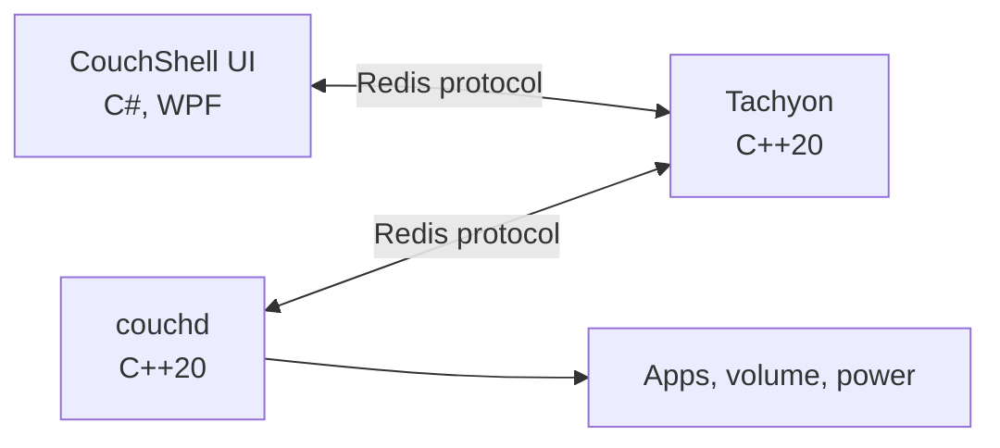

# CouchShell

[](https://github.com/healers2004/CouchShell/actions/workflows/ci.yml)
[](LICENSE)

A controller-first fullscreen interface for using a Windows PC from the couch. Connect your PC to a TV, pick up an Xbox-compatible controller, and open your games, streaming services and apps without reaching for a keyboard. Close what you were using and you land back on the same tile.

## Features

- **One library.** Installed Steam, Riot Games, Battle.net and Epic Games titles appear automatically, with their own artwork and icons, alongside streaming services and your own apps. Games can be narrowed down by store.
- **Controller control everywhere.** Menus, web apps and ordinary desktop programs all work from the controller, with an on-screen keyboard when you need to type.
- **Search anything installed.** Open any program in Windows' All apps list, including Store apps.
- **Reliable by design.** The interface can crash mid-game without losing anything: restart it and it finds what's running. Settings and history survive a power cut.
- **A console-style home screen.** The focused game's artwork fills the screen, and the Start button opens a menu with volume, sounds and power from anywhere.
- **System controls from the couch.** Volume, mute, sleep, restart and shut down.
- **Customizable.** Interface sounds, pointer speed, preferred browser, optional start at sign-in, and your own tiles.

## Install

1. Download `CouchShellSetup-<version>.exe` from [Releases](https://github.com/healers2004/CouchShell/releases).
2. Run it. It installs for your user account, with no administrator rights and nothing else to install first.

The installer isn't code-signed, so Windows SmartScreen may warn about it. Choose **More info**, then **Run anyway**.

**Requirements:** 64-bit Windows 10 version 1809 or later, or Windows 11. An Xbox-compatible controller is recommended, and a keyboard works too. Web apps need Chrome or Edge.

To remove CouchShell, use **Settings > Apps > Installed apps** in Windows. It asks whether to delete your settings and history as well.

## Controls

In CouchShell's menus:

| Action | Controller | Keyboard |
| --- | --- | --- |
| Move | D-pad or left stick | Arrow keys |
| Select | A | Enter |
| Back | B | Escape |
| Volume down, up | LB, RB | `-`, `=` |
| Mute | Y | M |
| Menu: volume, sounds, power | Start | G |
| Exit CouchShell | Start, then Exit to Windows | Alt+F4 |

While a web app or a program opened from Search is in front, the controller drives it. Games read the controller themselves and aren't affected.

| Action | Controller |
| --- | --- |
| Move the pointer | Left stick |
| Click | A |
| Back a page | B |
| Scroll | Right stick |
| Arrow keys | D-pad |
| Play or pause (Space) | X |
| Fullscreen (F) | Y |
| Volume down, up | LB, RB |
| On-screen keyboard | Start |
| Close the app and return | Hold View for a second |
| Return, leaving the app running (not web apps) | Tap View |
| Show or hide the controls bar | Press the right stick |

If Steam shows something before a game starts, such as a launch options dialog, CouchShell steps aside and the pointer controls work on it. Holding View cancels the launch.

## Adding your own apps

Create `%LOCALAPPDATA%\CouchShell\apps.json`. Your entries appear first, and reusing a built-in `id` replaces that app. Changes apply the next time CouchShell starts. A malformed entry is logged and skipped.

```json
{
  "apps": [
    {
      "id": "plex",
      "name": "Plex",
      "category": "watch",
      "type": "web",
      "target": "https://app.plex.tv",
      "color": "#1F2326"
    }
  ]
}
```

| Field | Meaning |
| --- | --- |
| `id` | Lowercase letters, digits, `-` and `_` |
| `name` | The tile's title |
| `category` | `games`, `watch` or `apps` |
| `type` | `exe`, `web`, `steam` or `shell` |
| `target` | Executable path (environment variables allowed), web address, Steam app id, or `shell:AppsFolder\\<id>` from Windows' All apps list |
| `args` | Optional: command line for an `exe` |
| `processName` | Optional: the process to watch, when it isn't the one started directly |
| `image` | Optional: picture for the tile, relative to `apps.json` |
| `logo` | Optional: a built-in logo: `youtube`, `netflix`, `chrome`, `spotify`, `steam`, `battlenet`, `epic` or `riot` |
| `color` | Optional: the tile's colour, like `#0E7C90` |
| `requires` | Optional: a file that must exist for the tile to appear |
| `installFolder` | Optional: the app counts as running while a program from this folder is |
| `watch` | Optional, with `installFolder`: `window` to count only while it has a window open, for launchers that sit in the tray |
| `controller` | Optional, for `web`: `pointer` (the default), or `keys` for sites built for TVs, where the D-pad navigates, A is Enter and B is Escape |
| `userAgent` | Optional, for `web`: what the browser tells the site it is |
| `window` | Optional, for `web`: `browser` for a normal browser window with an address bar |

Web apps open in Chrome or Edge, chosen under Settings, each with its own browser profile. Programs that aren't installed are left out.

## Troubleshooting

Data and logs are in `%LOCALAPPDATA%\CouchShell`, with one log per program under `logs`.

| Problem | What to check |
| --- | --- |
| "Background service isn't responding" | Another program may be using port 6380. See `logs\tachyon.log`. |
| A tile doesn't appear | The program isn't installed, or its entry was skipped. See `logs\ui.log`. |
| The controller does nothing | CouchShell reads XInput controllers. Check that the controller works in Windows first. |

## Architecture

CouchShell is three programs. The interface and the helper never talk to each other directly: both are ordinary Redis clients of the server, on localhost only.



| Part | Location | Role |
| --- | --- | --- |
| CouchShell UI | `ui/` | Screens, focus navigation and controller input |
| [Tachyon](https://github.com/healers2004/Tachyon) | `vendor/tachyon/` | Redis-compatible server with crash-safe storage |
| couchd | `couchd/` | Launches and watches apps, and controls volume and power |

- **Shared state** lives in Tachyon: app definitions in hashes, recent items and play history in lists.
- **Requests and events** use pub/sub. The UI publishes `launch youtube` on `couch:requests`. couchd starts it, publishes `started youtube` on `couch:events`, and later `exited youtube`.
- **Only standard commands** are used, so CouchShell also runs on a real Redis server.

Keeping state outside the interface is what makes crash recovery possible, and Tachyon writes to its log before acknowledging, so data survives a power cut.

## Building from source

Requires CMake, a C++20 compiler (MSVC on Windows, GCC or Clang on Linux) and the .NET 10 SDK. The UI and the couchd program are Windows-only. couchd's logic and Tachyon also build and test on Linux.

```
cmake -S . -B build
cmake --build build --config Debug
ctest --test-dir build -C Debug --output-on-failure
dotnet test ui/CouchShell.sln
```

End-to-end test of Tachyon and couchd together:

```
powershell -ExecutionPolicy Bypass -File tools\integration_test.ps1 build\vendor\tachyon\tachyon\Debug\tachyon.exe build\couchd\Debug\couchd.exe
```

Run a local build:

```
cmake --build build --config Release
dotnet build ui/CouchShell.sln -c Release
powershell -ExecutionPolicy Bypass -File tools\start-couchshell.ps1
```

`tools\stop-couchshell.ps1` stops it, and `tools\install-startup.ps1` runs a local build at sign-in (add `-Remove` to undo).

Build the installer, which also needs [Inno Setup 6](https://jrsoftware.org/isinfo.php). The result is in `out\`:

```
powershell -ExecutionPolicy Bypass -File tools\build-installer.ps1
```

`vendor/tachyon/` is an unmodified copy of Tachyon. Changes to the server belong in the Tachyon repository, then:

```
git subtree pull --prefix=vendor/tachyon https://github.com/healers2004/Tachyon.git <tag> --squash
```

## License

[MIT](LICENSE). Logo shapes are from [Simple Icons](https://simpleicons.org) (CC0). The marks belong to their owners and are used only to identify their services. CouchShell isn't affiliated with any of them.
